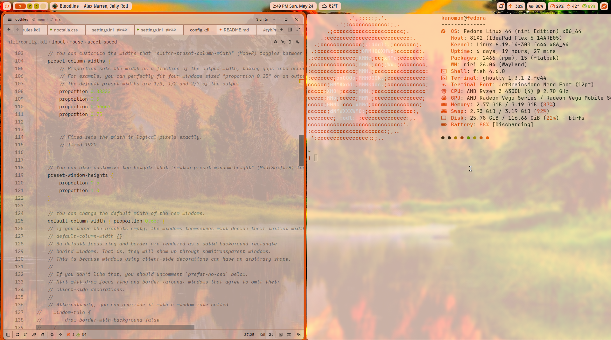

# **My niri dotfiles**
My dotfiles for the [niri](https://github.com/niri-wm/niri) scrollable-tiling window manager.

## **The specs**
- [DMS (DankMaterialShell)](https://github.com/AvengeMedia/DankMaterialShell) as my desktop shell (quickshell-based, launched at startup from the niri config)
- [Ghostty](https://ghostty.org) as my terminal
- [fish](https://fishshell.com) as my shell (a zsh + starship setup lives in here too)
- [Zed](https://zed.dev) as my main editor (helix config included)
- [matugen](https://github.com/InioX/matugen) for wallpaper-based theming
- btop, fastfetch, and GTK/Qt theme configs

> `noctalia/`, `noctalia1/`, and `niri/noctalia*.kdl` are leftovers from my old Noctalia setup — DMS is what's actually wired up in `niri/config.kdl` now.

## **How to apply**
1. Install niri, quickshell, DMS, ghostty, fish, btop, fastfetch, and matugen.
2. Back up these in `~/.config` if they exist: btop, fastfetch, fish, ghostty, gtk-3.0, gtk-4.0, helix, niri, matugen, qt5ct, qt6ct, starship.toml, .zshrc.
3. Symlink the repo folders into `~/.config` (e.g. `ln -s ~/dotfiles/niri ~/.config/niri`).
4. Symlink `Wallpapers` into your Pictures folder.

## **Keybinds**
See [keybinds.md](keybinds.md) for the keybind list.

## **Photos**

